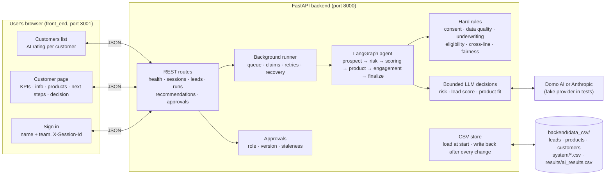
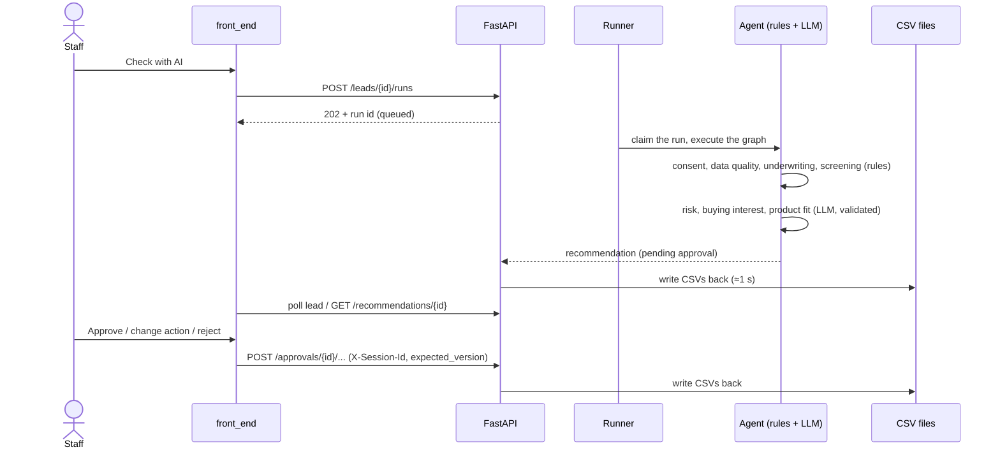

# System architecture

How the new-customer POC is put together. The backend runs the agent and owns all state; the
browser talks to it over HTTP; all data lives in CSV files.

## Components and data flow

## One run, step by step

## Boundaries

- **Front end** (`front_end/`): Next.js App Router + TanStack Query. `NEXT_PUBLIC_API_URL`
  points at the backend; its origin must be in the backend's `CORS_ORIGINS`.
- **Backend** (`backend/src/insurance_poc/`): `main.py` builds the app, opens the CSV store and starts
  the runner. Every trigger is asynchronous (202 + run id); the UI polls.
- **Storage** (`db/csv_store.py`): CSV files are the only data on disk. At start-up they are
  validated and loaded into a throwaway SQLite working copy in the OS temp folder (it keeps
  the queue's atomic claims and the approvals' first-decision-wins check safe); every write is
  saved back within about a second via temp file + rename, and the copy is deleted on shutdown.
- **Decision safety**: rules gate everything and the LLM only ranks or rates inside them;
  every LLM output is schema- and grounding-checked; a human approves every recommendation.
- **Integrations**: CRM and product catalogue are protocols (`integrations/base.py`) with mock
  implementations over the working copy.
- **Tests** (`tests/`): offline, with a fake LLM and a fixed copy of the demo CSVs
  (`tests/fixtures/demo_csv/`).
